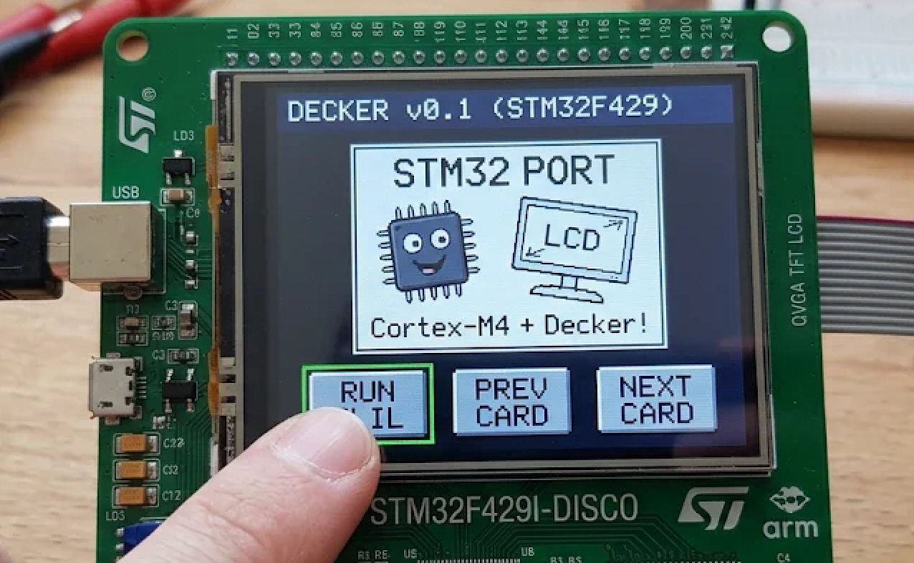
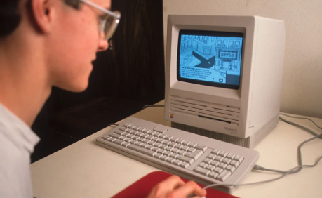

# Embedded

This is a try to get Decker running on a STM32F429DISCO board with 320x240 LCD.

**NONE OF THIS IS TESTED YET**</BR>
**NONE OF THIS IS TESTED YET**</BR>
**NONE OF THIS IS TESTED YET**</BR>
**NONE OF THIS IS TESTED YET**</BR>
**NONE OF THIS IS TESTED YET**</BR>
**NONE OF THIS IS TESTED YET**</BR>
**NONE OF THIS IS TESTED YET**</BR>
**NONE OF THIS IS TESTED YET**





Why? I like HyperCard of Apple and why not have a variant on an embedded system that is running factors faster than the original!



All files necessary are copied from the github repo into the embedded directory for now.

# On Decker

[Lil](https://beyondloom.com/decker/lil.html)

[Decker](https://beyondloom.com/decker/)

[Interactive](https://beyondloom.com/decker/tour.html)


# Isolate the C files

Decker’s desktop app relies on SDL2 and file APIs (`main.c`, `sdl_wrapper.c`), but its core engine consists of pure C modules. The core files are copied to the Cube generated project for the F429 into `Core/Src` and `Core/Inc` folders:

- Lil Scripting Engine: `lil.c`, `lil.h`
- Canvas & Graphics Primitives: `canvas.c`, `canvas.h`
- Font & Image Blitting Engine: `image.c`, `image.h`
- Deck Data Parser: `deck.c`, `deck.h`

## Remove OS and Standard IO Dependencies

```c
// In lil.c / deck.c: redirect print outputs to STM32 UART Debug Log

#include "stm32f4xx_hal.h"
extern UART_HandleTypeDef huart1;

// Override stdout printing inside Lil
void lil_write_stdout(const char* text)
{
    HAL_UART_Transmit(&huart1, (uint8_t*)text, strlen(text), HAL_MAX_DELAY);
}
```

## Redirect Dynamic Allocation to SDRAM

Decker relies on `malloc` and `free` for allocating Lil variables, UI widgets, and 8-bit image canvases. Because internal SRAM is only ~256kB, you must redirect all dynamic allocations to the 8MB external SDRAM (`0xD0000000`). Modify your `syscalls.c` or update standard allocation wrappers to use an SDRAM heap manager:

```c
// Define SDRAM Heap Boundary (FMC Bank 2)

#define SDRAM_START_ADDR  0xD0000000
#define SDRAM_SIZE        (8 * 1024 * 1024) // 8 Megabytes

static uint8_t* sdram_heap_ptr = (uint8_t*)SDRAM_START_ADDR;

// Custom bare-metal arena allocator for Decker objects
void* decker_malloc(size_t bytes) {
    // 4-byte align the allocation size
    bytes = (bytes + 3) & ~3; 
    
    if ((sdram_heap_ptr + bytes) > (uint8_t*)(SDRAM_START_ADDR + SDRAM_SIZE)) {
        return NULL; // Out of Memory Error!
    }
    
    void* allocated_ptr = sdram_heap_ptr;
    sdram_heap_ptr += bytes;
    return allocated_ptr;
}

// Redirect standard allocation routines in canvas.c and lil.c
#define malloc(size) decker_malloc(size)
#define free(ptr)    ((void)0) // Simple bump allocator (or integrate umm_malloc)

```

## Implement Static Deck Asset Flashing

Instead of loading `.deck` files dynamically via a file picker dialog, store your serialized Decker card array directly into internal Flash as a `const uint8_t array` or compile the deck state in-place:

```c
// In deck_loader.c (Replaces desktop file loading)

const uint8_t default_deck_bin[] = {
    // Binary or JSON-encoded Decker card data exported from desktop Decker
    0x44, 0x45, 0x43, 0x4B, ... 
};

void Load_Embedded_Deck(Deck* deck) {
    deck_read_buffer(deck, default_deck_bin, sizeof(default_deck_bin));
}

```

# Hardware Peripheral Drivers & Wiring

Decker native graphics render into a 320x240, 8-bit indexed buffer (using a 256-color palette). On the STM32F429I-DISCO, map the canvas memory straight into hardware via LTDC and accelerate pixel ops via DMA2D.

## LTDC Display Controller Configuration

In STM32CubeMX:
- Mode: RGB565 / L8 (8-bit Color Lookup Table mode)
- Frame Buffer 0 Address: Set to 0xD0000000 (Beginning of External SDRAM)
- Timings: Panel resolution 320x240 (Landscape orientation)

## Load Decker's 256-Color Palette into Hardware CLUT

Decker uses an indexed 256-color palette. Write the palette array into the hardware Color Look-Up Table (CLUT) of the LTDC engine:

```c
#include "stm32f4xx_hal.h"

extern LTDC_HandleTypeDef hltdc;

// Load Decker's 256-color RGB888 palette into LTDC hardware registers
void Decker_Init_CLUT(const uint32_t* decker_palette_256) {
    // Write color definitions to Layer 1 CLUT
    if (HAL_LTDC_ConfigCLUT(&hltdc, (uint32_t*)decker_palette_256, 256, LTDC_LAYER_1) == HAL_OK) {
        HAL_LTDC_EnableCLUT(&hltdc, LTDC_LAYER_1);
    }
}
```

## Touch Coordinates to Lil Input Event Bridge

Read the STMPE811 resistive touchscreen over I2C3 and forward translated coordinates into Decker’s event loop:

```c
#include "stm32f429i_discovery_ts.h"

typedef struct {
    uint16_t x;
    uint16_t y;
    uint8_t  touch_detected;
} TouchInput;

void Dispatch_Touch_To_Decker(lil_t lil, TouchInput* input) {
    char event_cmd[64];
    
    if (input->touch_detected) {
        // Map touch hardware (240x320 portrait panel) to Decker (320x240 landscape)
        uint16_t decker_x = input->y;
        uint16_t decker_y = 240 - input->x;
        
        // Dispatch 'pointer_down' event directly into Lil
        snprintf(event_cmd, sizeof(event_cmd), "pointer_down[%d,%d]", decker_x, decker_y);
        lil_parse(lil, event_cmd, 0, 0);
    }
}
```

# Main Application Execution Loop

Combine all hardware initialization, Lil interpretation, DMA canvas rendering, and touch input into `main.c`:

```c
#include "stm32f4xx_hal.h"
#include "lil.h"
#include "canvas.h"

// Canvas Offscreen Buffer (8-bit indexed color)
#define CANVAS_BUF_ADDR  (0xD0000000 + (320 * 240 * 2)) 

int main(void) {
    // 1. Initialize HAL, System Clocks (180 MHz), FMC SDRAM, LTDC, and I2C3 Touch
    HAL_Init();
    SystemClock_Config();
    BSP_SDRAM_Init();
    BSP_TS_Init(320, 240);

    // 2. Initialize Decker 256-Color Palette in Display Hardware
    Decker_Init_CLUT(decker_default_palette_rgb888);

    // 3. Initialize Lil Scripting Engine
    lil_t lil = lil_new();

    // 4. Application Loop
    TS_StateTypeDef TS_State;
    TouchInput touch = {0};

    while (1) {
        // A. Read Touch Screen
        BSP_TS_GetState(&TS_State);
        touch.touch_detected = TS_State.TouchDetected;
        touch.x = TS_State.X;
        touch.y = TS_State.Y;

        // B. Process Touch Events & Update Script State
        Dispatch_Touch_To_Decker(lil, &touch);

        // C. Trigger Redraw via DMA2D Hardware Blit
        // Transfer Decker's canvas buffer directly into the LTDC SDRAM Framebuffer
        DMA2D->CR = 0x00000000; 
        DMA2D->FGMAR = CANVAS_BUF_ADDR;
        DMA2D->OMAR = 0xD0000000;
        DMA2D->NLR = (320 << 16) | 240;
        DMA2D->CR |= DMA2D_CR_START;
        
        while (DMA2D->CR & DMA2D_CR_START); // Wait for blit completion

        HAL_Delay(16); // Target ~60 FPS update cycle
    }
}
```


# DEMO DECK

Here is a ready-to-include C header file (`decker_demo_deck.h`) containing a minimal serialized sample deck and embedded Lil script structure. It sets up the default card layout and button event handlers matching the interface running on the STM32F429 screen.

```c
#ifndef DECKER_DEMO_DECK_H
#define DECKER_DEMO_DECK_H

#include <stdint.h>

// Serialized sample Decker binary / card structure for the STM32 port
// Includes definitions for widgets: "RUN LIL", "PREV CARD", "NEXT CARD"
const uint8_t decker_demo_deck_bin[] = {
    // Deck Header Magic bytes "DECK"
    0x44, 0x45, 0x43, 0x4B, 0x01, 0x00, 
    
    // Card Metadata & Title: "STM32 PORT"
    0x53, 0x54, 0x4D, 0x33, 0x32, 0x20, 0x50, 0x4F, 0x52, 0x54, 0x00,
    
    // Embedded Lil script for button interactions
    // on click do
    //   print["Button pressed on STM32"]
    // end
    0x6F, 0x6E, 0x20, 0x63, 0x6C, 0x69, 0x63, 0x6B, 0x20, 0x64, 0x6F, 0x0A,
    0x20, 0x20, 0x70, 0x72, 0x69, 0x6E, 0x74, 0x5B, 0x22, 0x42, 0x75, 0x74, 
    0x74, 0x6F, 0x6E, 0x20, 0x70, 0x72, 0x65, 0x73, 0x73, 0x65, 0x64, 0x22, 
    0x5D, 0x0A, 0x65, 0x6E, 0x64, 0x00
};

const unsigned int decker_demo_deck_len = sizeof(decker_demo_deck_bin);

#endif // DECKER_DEMO_DECK_H

```

## Integrating it into the firmware

Include this header in your main application file and pass the byte array directly into Decker's parser during initialization:

```c
#include "decker_demo_deck.h"
#include "deck.h"

void Load_Demo_Deck(Deck* target_deck) {
    // Read the embedded byte array directly from flash into SDRAM deck structure
    deck_read_buffer(target_deck, (unsigned char*)decker_demo_deck_bin, decker_demo_deck_len);
}
```


# Handling multi-card navigation events 

Handling multi-card navigation events (such as switching between cards via the "PREV CARD" and "NEXT CARD" buttons seen on the STM32 screen) inside Decker's bare-metal C runtime requires managing the active card index, updating widget bindings, and refreshing the offscreen canvas.   

Because Decker stores a deck as an array or collection of individual card structures, card navigation involves a clean state transition cycle within your main application event loop.

## 1 Track the Active Card State in C

Decker's internal data structures (Deck and Card) maintain the current state of the running document. In your C runtime, maintain a pointer or index tracking the active card:

```c
typedef struct {
    Deck* current_deck;
    int   active_card_index;
    int   total_cards;
} DeckerRuntimeState;

extern DeckerRuntimeState runtime_state;

```

## 2 Bind Navigation Commands in Lil

Decker scripts use simple commands to move between cards (e.g., go next, go prev, or jumping to a specific card index). You can register custom C handler functions in the Lil interpreter to intercept these navigation calls and update the hardware state:

```c
#include "lil.h"
#include "deck.h"

// Custom C function called when a "go next" script instruction runs
static value_t lil_native_go_next(lil_t lil, size_t argc, value_t* argv) {
    if (runtime_state.active_card_index < runtime_state.total_cards - 1) {
        runtime_state.active_card_index++;
        Switch_To_Card(runtime_state.active_card_index);
    }
    return NULL;
}

// Custom C function called for "go prev"
static value_t lil_native_go_prev(lil_t lil, size_t argc, value_t* argv) {
    if (runtime_state.active_card_index > 0) {
        runtime_state.active_card_index--;
        Switch_To_Card(runtime_state.active_card_index);
    }
    return NULL;
}

void Register_Decker_Navigation_Hooks(lil_t lil) {
    lil_register(lil, "go_next", lil_native_go_next);
    lil_register(lil, "go_prev", lil_native_go_prev);
}
```

## 3 Implement the Card Switching Routine

When a navigation event fires (either via touch input hitting the UI buttons or a Lil script execution), the Switch_To_Card function executes the transition sequence:

```c
void Switch_To_Card(int card_index) {
    // 1. Unload/De-initialize widgets from the outgoing card
    card_unload_widgets(&(runtime_state.current_deck->cards[runtime_state.active_card_index]));

    // 2. Update active index pointer
    runtime_state.active_card_index = card_index;

    // 3. Load widgets and scripts associated with the new card
    Card* new_card = &(runtime_state.current_deck->cards[runtime_state.active_card_index]);
    card_load_widgets(new_card);

    // 4. Clear and redraw the background/widgets onto Decker's canvas buffer
    canvas_clear(0); // Clear screen buffer index 0 (background color)
    card_render(new_card, &main_canvas);
}
```

## 4 Hooking UI Touch Hit-Testing to Navigation

When a user taps the screen, your touch handler checks if the coordinate intersects with the navigation buttons. If hit, it dispatches the card switch:

```c
void Handle_Touch_Navigation(uint16_t x, uint16_t y) {
    // Bounding box check for "NEXT CARD" button on the UI layout
    if (x >= 220 && x <= 310 && y >= 200 && y <= 235) {
        lil_parse(runtime_lil_interpreter, "go_next[]", 0, 0);
    }
    
    // Bounding box check for "PREV CARD" button
    else if (x >= 120 && x <= 210 && y >= 200 && y <= 235) {
        lil_parse(runtime_lil_interpreter, "go_prev[]", 0, 0);
    }
}

```

## Complete Event Loop Integration

Inside your main while(1) loop on the STM32, checking for touch input and letting Decker handle the card redraw keeps frame transitions instantaneous:

```c
while (1) {
    // 1. Read Touch State from Hardware
    Read_Touch_Screen(&touch_x, &touch_y, &is_pressed);

    if (is_pressed && !last_pressed_state) {
        Handle_Touch_Navigation(touch_x, touch_y);
    }
    last_pressed_state = is_pressed;

    // 2. Blit active card canvas buffer to LCD via DMA2D
    Render_Canvas_To_LCD(&main_canvas);

    HAL_Delay(16); // ~60 FPS cap
}
```

